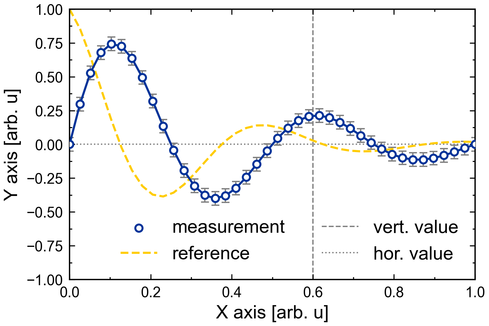
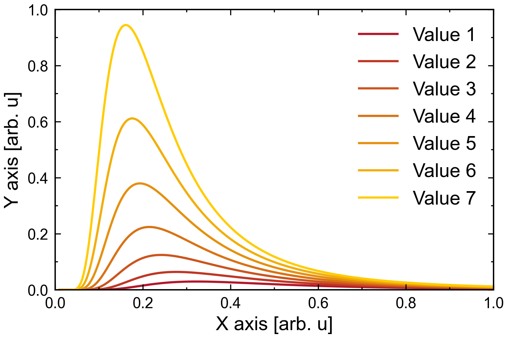
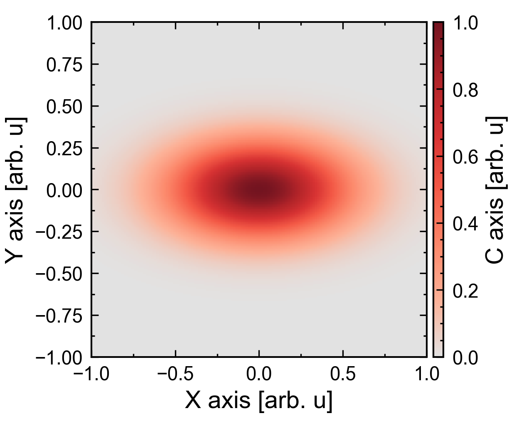
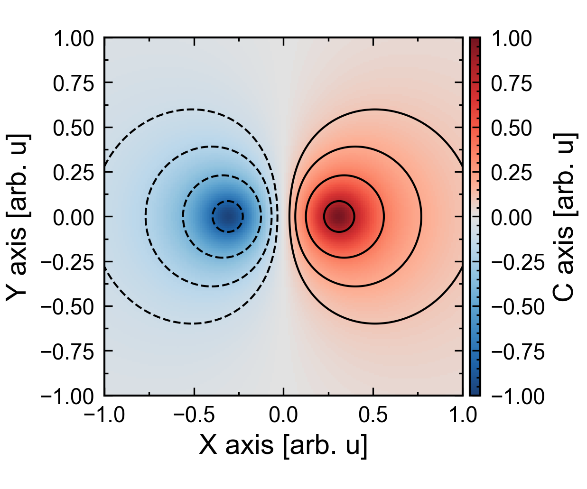
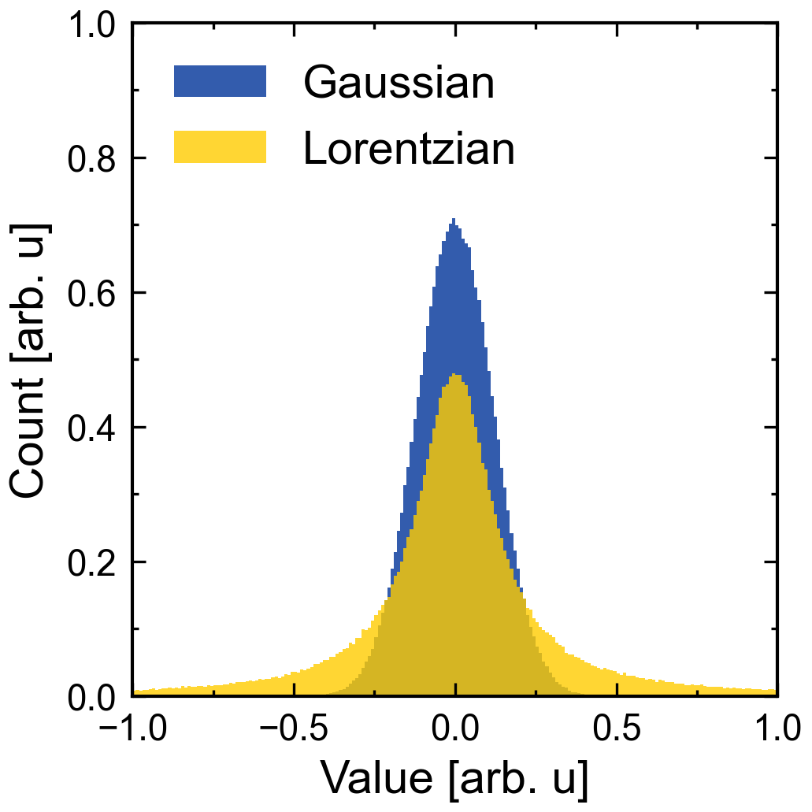
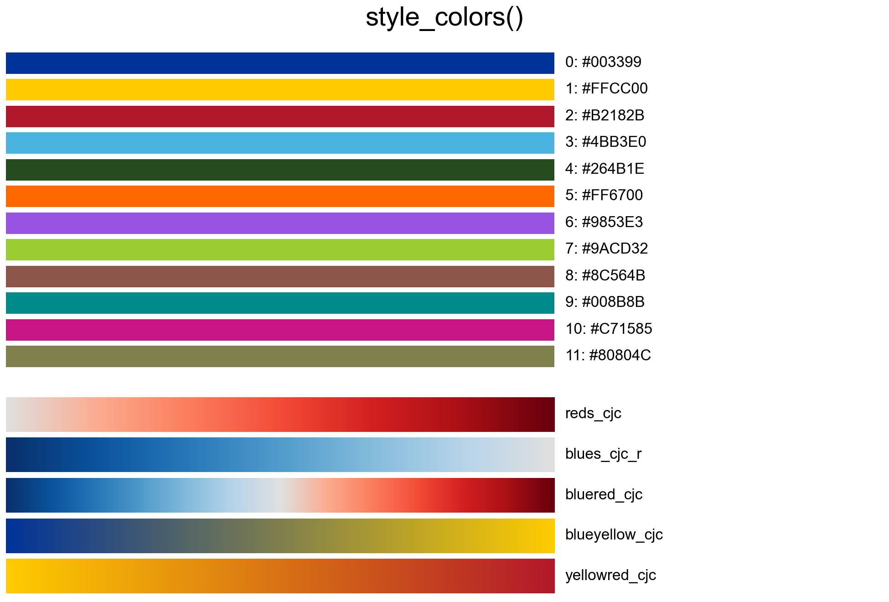

# cjcplot

[](https://github.com/cjcscheper/cjcplot/actions/workflows/tests.yml)

Publication-ready matplotlib figures sized to a LaTeX text width, with one
consistent, switchable style.

## Install

```bash
pip install git+https://github.com/cjcscheper/cjcplot.git
```

For development, clone the repository and install it editable:

```bash
pip install -e ".[test]"
```

## Quick start

```python
import numpy as np
from cjcplot import plot_1d

time_ps = np.linspace(0, 10, 200)
fig, ax = plot_1d(
    time_ps, np.cos(2 * time_ps) * np.exp(-time_ps / 4),
    xlabel="Time [ps]", ylabel="Field [a.u.]",
    fig_aspect_ratio=(0.75, 0.5),   # (width, height) as fractions of the text width
)
```

**Importing cjcplot applies the cjc style** to all matplotlib figures (fonts,
ticks, line colours, default colormap). Switch with `use_style(...)`.

## Functions

| Function | Use |
|---|---|
| `plot_1d` | one or more traces: lines, markers, x/y error bars, reference lines |
| `plot_histogram_1d` | one or more overlaid histograms (shared bins, `density`, `weights`, fills, hatches) |
| `plot_2d` | heatmap with optional contours; colorbar sized relative to the plot, `cbar_symmetric`, `nan_color` |
| `plot_3d` | placeholder, not implemented yet |

Every plot function returns `(fig, ax)` and accepts `ax=` to draw into an
existing figure. See `examples/` for one script per function.

<!-- One centred image per row; widths = fig_aspect_ratio[0] x 640 px, so all fonts appear at the same size. -->
<p align="center">
  
</p>
<p align="center">
  
</p>
<p align="center">
  
</p>
<p align="center">
  
</p>
<p align="center">
  
</p>

## Figure size: fractions of your document's text width

Figures are sized as fractions of the text width of the document they go into.
The default, `fig_textwidth_pt=497`, is the text width of the LaTeX document
cjcplot was built for, but any document with a known text width works the same
way, for example Word or PowerPoint. Inserted at that same width, nothing gets
rescaled, so **the fonts in the figure keep the exact point size of the style**
(14 pt labels, 11 pt ticks), in the same units as the document's own text. To
match your body text, set the font sizes in the style to that size.

1. Find the text width of your document in points and pass it as
   `fig_textwidth_pt` (default 497):
   - **LaTeX:** put `\the\textwidth` in the document; it prints e.g. `497.0pt`.
   - **Word:** page width minus the left and right margins, e.g. A4 with 2.5 cm
     margins: 21.0 − 5.0 = 16.0 cm = 454 pt (1 cm ≈ 28.35 pt).
   - **PowerPoint:** the slide width, e.g. 33.87 cm = 960 pt for a 16:9 slide,
     or the width of the area you place figures in.
   - **Anything else** (a poster, a web page, another editor): the width of the
     area the figure goes into, converted to points.
2. `fig_aspect_ratio=(width, height)` gives the figure size as fractions of that
   text width: `(0.5, 0.5)` is half the text width wide and half the text width
   tall. Defaults: `(0.5, 0.5)` for `plot_1d` and `plot_histogram_1d`,
   `(0.6, 0.5)` for `plot_2d`.
3. Insert the figure at the same width fraction, so it is not rescaled:
   - **LaTeX:**

     ```latex
     \includegraphics[width=0.5\textwidth]{figure.pdf}   % for fig_aspect_ratio=(0.5, ...)
     ```
   - **Word / PowerPoint:** insert the image and keep it at 100 % size (or set its
     width to the same fraction of the text width, e.g. 8.0 cm for 0.5 × 16.0 cm).

## Colorbar size

- `cbar_aspect_ratio=(width, height)` sizes the colorbar as fractions of the plot
  box (inside the axes, so titles and labels do not change it). The default
  `(0.03, 1.0)` is a bar as tall as the plot.

## Colours and colormaps

```python
from cjcplot import style_colors
color = style_colors()[2]       # third colour of the active style
```

Use `style_colors()` instead of hard-coded hex values, so scripts follow the
style when it is switched. The cjc style registers seven colormaps that work by
name everywhere (`cmap="reds_cjc"`), each with a reversed `_r` version:

- `reds_cjc` (default heatmap colormap): light grey to dark red.
- `blues_cjc`: light grey to dark blue.
- `bluered_cjc` (diverging, for signed data): dark blue, light grey at zero,
  dark red.
- `blueyellow_cjc`, `yellowblue_cjc`, `yellowred_cjc`, `redyellow_cjc`: straight
  between the first three palette colours (blue, yellow, red), without passing
  through white or grey. Both directions have their own name.

Line colours from a colormap, first trace at its left end and last at its right end:

```python
from cjcplot import colors_from_cmap, plot_1d
plot_1d(x_traces, y_traces, colors=colors_from_cmap("blueyellow_cjc", len(y_traces)))
```

Every name gives the order from low to high values; the suffix `_r` gives the
reversed map (`reds_cjc_r` runs from dark red to grey).

The grey ends and the grey centre stay distinct from NaN cells, which
`plot_2d` draws white (`nan_color`). For signed data use
`plot_2d(..., cbar_symmetric=True)`: the limits become symmetric around zero
and, without an explicit `cmap`, `bluered_cjc` is used.



## Styles

```python
from cjcplot import use_style, available_styles

available_styles()                 # bundled styles, e.g. ['cjc']
use_style("cjc")                   # a bundled style
use_style("path/to/my_style")      # your own style folder
use_style("path/to/my.mplstyle")   # a single matplotlib style file
```

A style folder `my_style/` contains `my_style.mplstyle` (fonts, ticks, dpi) and
optionally `colors.py` with `PALETTE`, `COLORMAPS`, `DEFAULT_CMAP` and
`DIVERGING_CMAP`. To add a style to the package, copy `src/cjcplot/styles/cjc/`,
rename the folder and its `.mplstyle`, and edit both files.

**Keep `styles/cjc/`:** it is the built-in default that importing cjcplot applies.
Add your own style next to it instead of replacing it. If it is missing, cjcplot
warns on import and falls back to matplotlib's default style.

## License

MIT, see [LICENSE](LICENSE).
